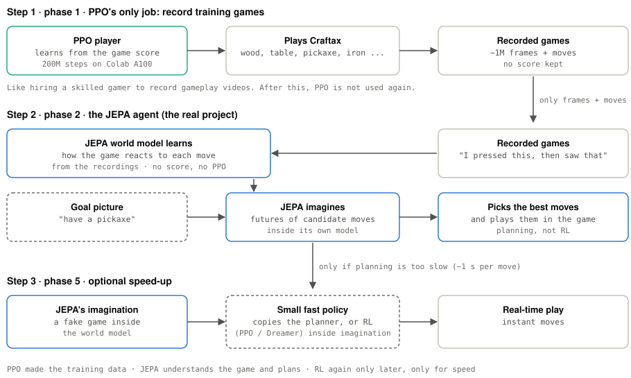

# jepa-game-agent

A JEPA agent that **lives inside a game world**: it sees the screen, predicts
what its actions will do in latent space, remembers, picks its own goals, and
acts. JEPA as the *player's mind*, not as a game generator.

Spin-off of [jepa-playground](https://github.com/nunenuh/jepa-playground),
where experiment 09 showed what a JEPA world model can and can't do yet:

- It **plans**: LeWorldModel pushes the T to the goal in Push-T (74–78%),
  with no reward.
- It **knows physics**: its surprise catches teleported, frozen and reversed
  motion (AUC 0.93–1.00).
- It **fails on long tasks**: whole episodes 2/21, its own goals 1/20.
- **Hierarchy helps**: H-JEPA in Visual AntMaze, 20% flat → 80% with 3 levels.
- It is **slow** (~1 s per move), has **no memory** and **no goals of its own**.

This repo adds one piece per failure:

| Missing | Piece |
|---|---|
| Long tasks | H-JEPA hierarchy + an LLM that breaks a task into steps |
| Speed | a fast policy trained inside the JEPA's imagination (Dreamer / LeWAM style) |
| Memory | a memory bank / map of past latents |
| Own goals | curiosity from surprise + goals from the user or an LLM |

## How it works

<picture>
  <source media="(prefers-color-scheme: dark)" srcset="docs/assets/how-it-works-dark.svg">
  
</picture>

PPO only records training games. The JEPA agent learns how the world works
from those recordings (no score, no PPO) and plans by imagining futures. RL
comes back only if planning is too slow, to train a fast policy inside the
JEPA's imagination. (Diagram source: `docs/diagrams/how_it_works.py`.)

The world: [Craftax](https://github.com/MichaelTMatthews/Craftax), a 2D
Minecraft-like game written in JAX: fast enough to generate millions of
frames on one GPU, rich enough to need long plans (wood → table → pickaxe →
stone → ...).

Status: **foundation built, phase 0 (design note) next.** The plan:
[docs/PLAN.md](docs/PLAN.md) · what each part does: [docs/SPECS.md](docs/SPECS.md)
· progress: [ROADMAP.md](ROADMAP.md).

## Code

```
src/jepa_game_agent/
  config.py        validated settings (model, training, planner)
  envs/            GameEnv interface · GridWorld (tests, CPU) · CraftaxEnv (JAX, optional)
  data/            collect, save/load episodes, training windows
  models/          Encoder · causal action-conditioned Predictor · SIGReg · WorldModel
  planning/        categorical CEM · plan_to_goal over imagined latents
  memory/          LatentMemory: remember latents, find them again
  surprise.py      SurpriseMeter: "that can't happen" scores
  training/        resumable training loop (Colab sessions end)
  cli.py           jga collect / jga train
tests/             unit tests, CPU-only, seconds
```

## Quick start

```bash
uv venv --python 3.11
uv pip install torch --index-url https://download.pytorch.org/whl/cpu
uv pip install -e ".[dev]"                 # ".[dev,craftax]" for the real game
uv run --no-sync pytest                    # all unit tests, ~99% coverage

# the whole pipeline on the built-in grid world, on a CPU
uv run --no-sync jga collect --episodes 20 --out data/grid.npz
uv run --no-sync jga train --data data/grid.npz --num-actions 5 --steps 200 --checkpoint checkpoints/grid.pt

# real Craftax frames
uv run --no-sync jga collect --env Craftax-Classic-Pixels-v1 --episodes 2 --max-steps 500 --out data/craftax.npz
```

Development rules and checks: [CONTRIBUTING.md](CONTRIBUTING.md).

## Hardware

Training on Google Colab (A100 40 GB at most, in resumable 3–6 h chunks);
playing and inference on a laptop GPU (RTX A2000, 4 GB, Docker).
