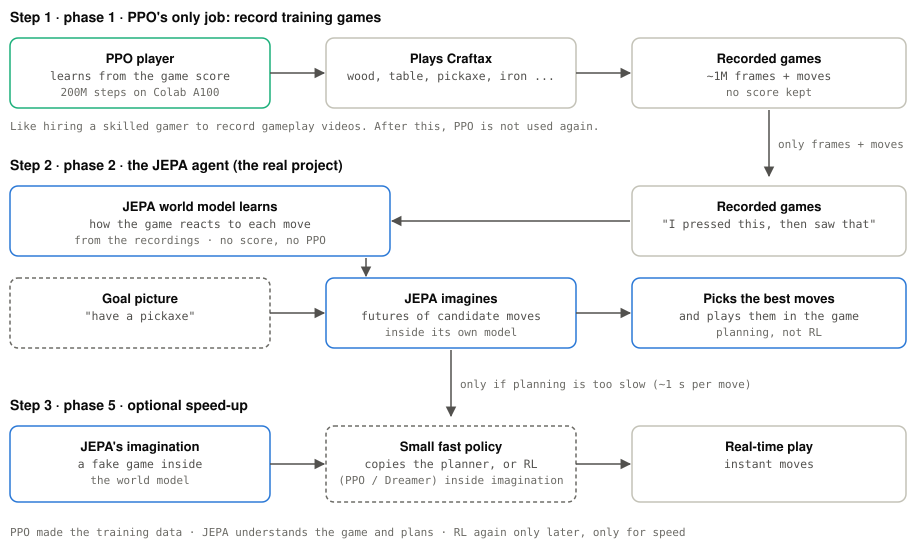

# jepa-game-agent

A JEPA agent, built toward **acting in the real world**: it sees the screen,
predicts what its actions will do in latent space, remembers, picks its own
goals, and acts. JEPA as the *agent's mind*, not as a game generator. Craftax
is the training ground; a later phase moves the agent to a robot-like world.

Spin-off of [jepa-playground](https://github.com/nunenuh/jepa-playground),
where experiment 09 showed what a JEPA world model can and can't do yet:

- It **plans**: LeWorldModel pushes the T to the goal in Push-T (74–78%),
  with no reward.
- It **knows physics**: its surprise catches teleported, frozen and reversed
  motion (AUC 0.93–1.00).
- It **fails on long tasks**: whole episodes 2/21, its own goals 1/20.
- **Hierarchy helps**: H-JEPA in Visual AntMaze, 20% flat → 80% with 3 levels.
- It is **slow** (~1 s per move), has **no memory** and **no goals of its own**.

This repo adds one piece per failure:

| Missing | Piece |
|---|---|
| Long tasks | H-JEPA hierarchy + an LLM that breaks a task into steps |
| Speed | a fast policy trained inside the JEPA's imagination (Dreamer / LeWAM style) |
| Memory | a memory bank / map of past latents |
| Own goals | curiosity from surprise + goals from the user or an LLM |

## How it works

<picture>
  <source media="(prefers-color-scheme: dark)" srcset="docs/assets/how-it-works-dark.svg">
  
</picture>

PPO only records training games. The JEPA agent learns how the world works
from those recordings (no score, no PPO) and plans by imagining futures. RL
comes back only if planning is too slow, to train a fast policy inside the
JEPA's imagination. (Diagram source: `docs/diagrams/how_it_works.py`.)

The world: [Craftax](https://github.com/MichaelTMatthews/Craftax), a 2D
Minecraft-like game written in JAX: fast enough to generate millions of
frames on one GPU, rich enough to need long plans (wood → table → pickaxe →
stone → ...).

## Where it stands (phase 3: crafting)

What the agent does at play time. It sees pixels only; game-state labels only train the small heads and
score results, and the world model never sees a reward.

```
screen ──► encoder ──► 9×9 tile latents ──► CEM planner: imagine many action sequences with the predictor
                                                │   cost = distance to the next goal picture
goal pictures (wood ×2 → table → pickaxe ...) ──┘        + λ × imagined zombie next to me (threat head)
                                                │   top model plans 4-step chunks, action prior guides the search
                                                ▼
                                       first action of the best sequence ──► game ──► next screen
```

| | v2 (one 128-number latent) | v4 (one latent per tile) |
|---|---|---|
| sees an adjacent zombie (AUC) | 0.65 | **0.967** |
| reach a goal picture, K = 5 / 10 steps | 32% / 25% | **51% / 35%** |
| chain: place a table (round 9 setup) | 38% | rerun 2026-11-04 |
| episode length, median | 124 steps | ~150–174 (partial run) |

Zombies cause nearly every death, so v4 was built to see them. Details, every run and the failures:
[experiments/results](experiments/results/README.md) · plan: [docs/PLAN.md](docs/PLAN.md) · v4 design:
[docs/DESIGN_V4.md](docs/DESIGN_V4.md) · progress: [ROADMAP.md](ROADMAP.md).

## Code

```
src/jepa_game_agent/
  config.py        validated settings (model, training, planner)
  envs/            GameEnv interface · GridWorld (tests, CPU) · CraftaxEnv (JAX, optional)
  data/            collect, save/load episodes, training windows
  models/          Encoder · SpatialEncoder (v4 tiles) · Predictors · SIGReg · WorldModel
                   top model · action prior · readout/critic heads · ThreatHead
  planning/        categorical CEM · plan_to_goal · two-level planning
  evaluation/      JEPA and hierarchical agents · reach / achievement / chain runners · probes
  memory/          LatentMemory: remember latents, find them again
  surprise.py      SurpriseMeter: "that can't happen" scores
  training/        resumable loops: world model, top, prior, readout, threat
  cli.py           jga collect · train · train-top/prior/readout/threat · plan · plan-achievement · ...
tests/             unit tests, CPU-only, seconds
```

## Quick start

```bash
uv venv --python 3.11
uv pip install torch --index-url https://download.pytorch.org/whl/cpu
uv pip install -e ".[dev]"                 # ".[dev,craftax]" for the real game
uv run --no-sync pytest                    # all unit tests, ~99% coverage

# the whole pipeline on the built-in grid world, on a CPU
uv run --no-sync jga collect --episodes 20 --out data/grid.npz
uv run --no-sync jga train --data data/grid.npz --num-actions 5 --steps 200 --checkpoint checkpoints/grid.pt

# real Craftax frames
uv run --no-sync jga collect --env Craftax-Classic-Pixels-v1 --episodes 2 --max-steps 500 --out data/craftax.npz
```

Development rules and checks: [CONTRIBUTING.md](CONTRIBUTING.md).

## Hardware

Training on Google Colab (A100 40 GB at most, in resumable 3–6 h chunks);
playing and inference on a laptop GPU (RTX A2000, 4 GB, Docker).
